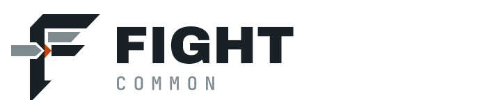

<picture>
  <source media="(prefers-color-scheme: dark)" srcset="docs/assets/identity/fight-common-readme-dark.svg">
  
</picture>

# Fight Common

[](https://github.com/johnnickell/fight-common/actions/workflows/tests.yml)
[](https://www.php.net/)
[](LICENSE)
[](https://github.com/johnnickell/fight-common/releases/latest)

Fight Common is a PHP library for tasks like checking input, handling commands and events, and sending email.
Use the parts you need. You can keep your business rules separate from the framework and services you use.

Install with [Composer](https://getcomposer.org/), PHP's package manager. You need PHP 8.5 or later.

```bash
composer require johnnickell/fight-common
```

## Choose a capability

- [Quick Start](https://johnnickell.github.io/fight-common/quick-start/) — Run an order example without a framework.
- [Components](https://johnnickell.github.io/fight-common/#component-atlas) — Find a guide for the part you need.
- [Frameworks](https://johnnickell.github.io/fight-common/frameworks/framework-support/) — Check support and find setup guides.

## Inward architecture

The [Architecture guide](https://johnnickell.github.io/fight-common/architecture/) explains the dependency rule:
**Adapter → Application → Domain**. Adapters connect to tools such as databases and frameworks. Application code
runs use cases. The domain holds the business rules and does not depend on the other two layers.

## JSend response compatibility

The framework-neutral JSend response format is unchanged. Use the typed response API; the old raw Symfony
response and unsafe exception presenters have been removed. See the
[Validation guide](https://johnnickell.github.io/fight-common/components/validation/) for response behavior.

## MCP foundation imports

If you use the Model Context Protocol (MCP), start with the
[removal inventory](docs/maintenance/v2-removal-inventory.md#mcp-foundation-declaration-moves) for canonical
imports and what to do before upgrading saved PHP objects or changing container registrations. `McpResponder`
and `McpDiagnostics` stay in the root MCP namespace. The [v1.5 foundation map](docs/maintenance/mcp-foundation-namespaces.md)
records the old aliases, and the [aggregate namespace map](docs/mcp-namespaces.md#approved-aggregate-alignment-target)
covers the separate aggregate alignment.

See [execution observations](docs/execution-observations.md#typed-activity-execution-facts) for optional activity
records and their limits, and [durable Tasks](docs/durable-tasks.md#explicit-composition) for the separate
storage, transaction and read interfaces.

## Project routes

[Contributing](https://johnnickell.github.io/fight-common/maintenance/contributing/) ·
[Repository](https://github.com/johnnickell/fight-common) ·
[Source](https://github.com/johnnickell/fight-common/tree/main/src) ·
[Changelog](CHANGELOG.md) · [MIT License](LICENSE) ·
[Glossary](GLOSSARY.md) · [Local tooling](docs/engineering/LOCAL_TOOLING.md)

Copyright © 2026 John Nickell.
